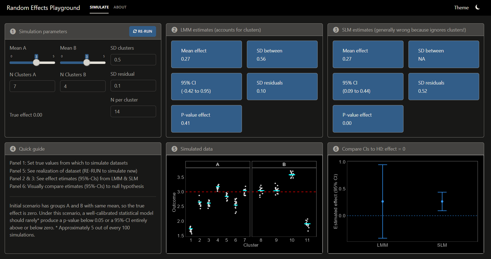

# Random Effects Playground

### Features
This didactic Shiny app provides an intuitive introduction to clustered data and 
linear mixed-effects models (LMMs) for non-statisticians. Users can simulate clustered 
data by adjusting between-cluster variance, residual variance, and the true difference between groups. 
The simulated data are analysed using both LMMs and simple linear models (SLMs), allowing users 
to compare estimated effects, p-values, and confidence intervals. The comparison illustrates why 
accounting for clustering is essential for valid statistical inference.

### Preview


### Dependencies
- R 4.5.1
- tidyverse · shiny · bslib · lme4

### Data Source
- Simulated data, no external data needed.

### Installation
* Install R and Rstudio (and git)
* In Terminal/cmd/bash: Clone this repository
* Open this repo in Rstudio as a project (e.g. double-click **didactic_randeff_app.Rproj**)
* In R console:
  * Activate renv: ```renv::activate()```
  * Check needed R packages: ```renv::status()```
  * Install packages from renv.lock: ```renv::restore()```

### Usage - Start app (with R-studio)
Open repo in Rstudio as a project (e.g. double-click ```didactic_randeff_app.Rproj```)  
Easiest is to open app.R and then use the "Run app" button  
For more control, use Rstudio's terminal and do  
```bash
Rscript --vanilla -e "shiny::runApp(launch.browser = TRUE)"
```
More arguments can be provided, e.g.:  
```bash
Rscript --vanilla -e "shiny::runApp(launch.browser = TRUE, port = 3838, host = '127.0.0.1')"
```

### Usage - Start app (with PowerShell)

Navigate to dir containing Rscript.exe

```bash
cd <dir containing Rscript.exe>
```

Example ```cd "C:\Program Files\R\R-4.5.1\bin\"``` path many vary on each computer.

Install dependencies (skip if you already executed installation steps above)

```bash
.\Rscript -e "renv::restore(project = '.../didactic_randeff_app')"
```

Call Rscript with repo path as argument to runApp(), below replace ... by your path to repo

```bash
.\Rscript --no-init-file -e "shiny::runApp(appDir = '.../didactic_randeff_app', launch.browser = TRUE)"
```

### Project Structure
```text
didactic_randeff_app/
│
├── app.R                    # Main Shiny app entry poinz
├── src/                     # Shared functions, ui and server components
├── contents/                # Static contents and text
├── styles/                  # CSS and visual styling
│
├── sandbox/                 # Experimental code and development
├── renv/                    # Project-specific R package library
├── .Rprofile                # Project startup configuration
├── .gitignore               # Git exclusions
├── renv.lock                # Reproducible package dependencies
├── didactic_randeff_app.Rproj
├── LICENSE
└── README.md
```

### Credits
Web-app concept, analytics and implementation by Serge Zaugg ([Pollito-ML](https://github.com/sergezaugg))

### License
[MIT License - © 2026 Serge Zaugg](LICENSE)


